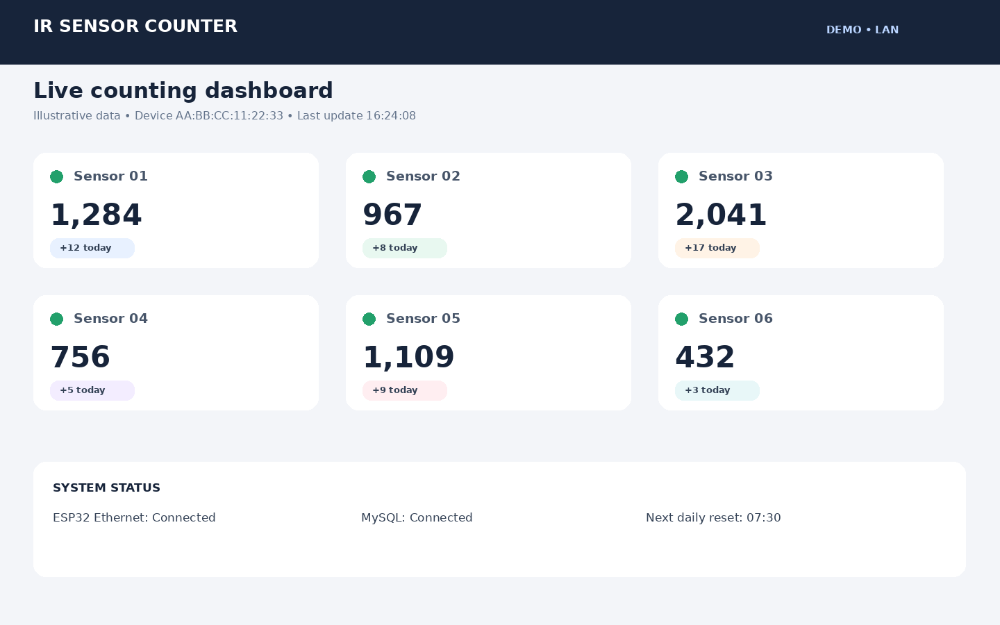
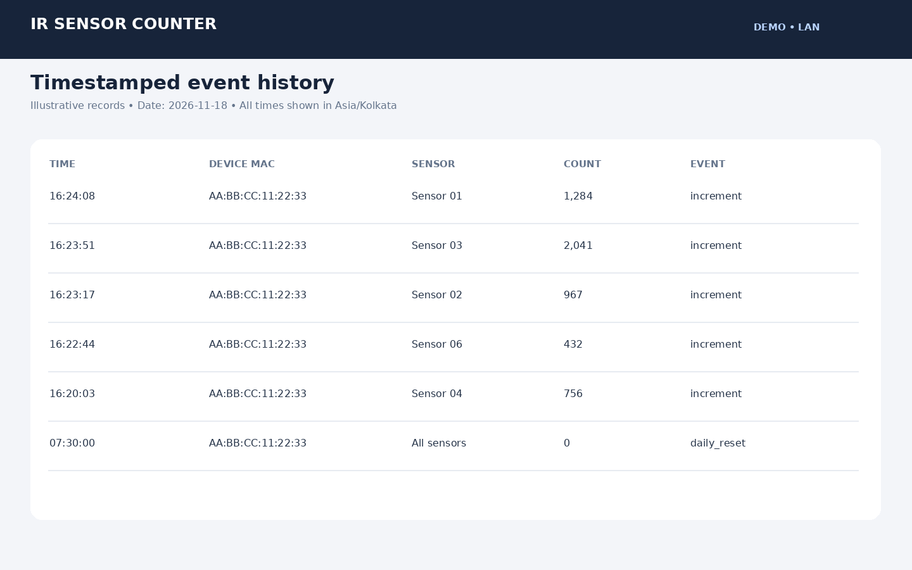
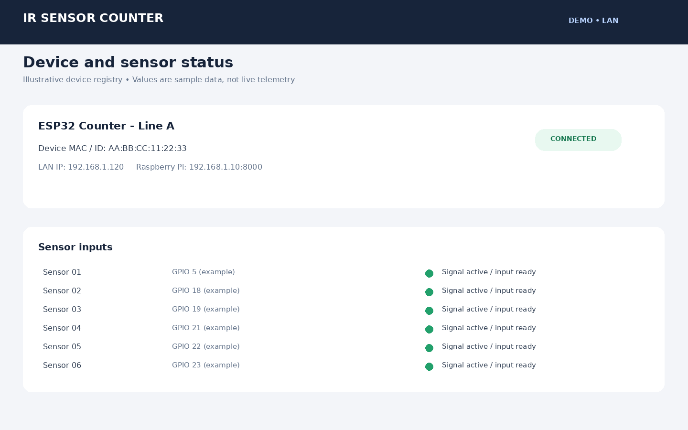

# 📟 ESP32 LAN IR Sensor Counter

**Real-time object counting with up to six IR sensors, wired Ethernet, a Raspberry Pi backend and a live browser dashboard.**

An ESP32 with a W5500 Ethernet interface reads up to six IR sensors and sends one event per detected object over the wired LAN to a FastAPI service on a Raspberry Pi. The Pi stores every event in MySQL, keeps daily totals and pushes live updates to browser dashboards over WebSockets. Counts reset automatically every morning and survive reboots and power cuts.

> ℹ️ This is a showcase repository. The source code is private; this page describes the design, features and tech used. Device IDs, MAC/IP addresses, counts and screenshots are fictional sample data, and the screenshots are illustrative dashboard mockups.

---

## 📸 Screenshots

### Live counting dashboard
Per-sensor totals with today's increments, plus ESP32, MySQL and next-reset status.



### Timestamped event history
Every detection is stored as its own event row, along with the daily reset marker.



### Device and sensor status
Device registry showing the ESP32 identity, LAN addresses and the state of each sensor input.



---

## 🏗️ Architecture

```text
IR sensors (1..6)
       |
       v
ESP32 + W5500 Ethernet  --- HTTP POST over LAN --->  Raspberry Pi / FastAPI
                                                        |              \
                                                        v               \ WebSocket
                                                      MySQL              v
                                                               Browser dashboard
```

The ESP32 sends a **pulse event** for each detected object rather than a locally kept total. The server is the single source of truth for counts, so an ESP32 reboot never loses or corrupts a count.

## ✨ Features

| Area | What it does |
|---|---|
| **Sensing** | Up to six independently identified IR sensors per ESP32, with edge detection and debouncing |
| **Networking** | Wired LAN via ESP32 + W5500 Ethernet; failed sends are queued and retried instead of dropped |
| **Backend** | FastAPI endpoints for sensor events, current totals and date-wise history |
| **Storage** | MySQL with an immutable event log plus a daily-summary table for fast restores |
| **Live updates** | WebSocket push to every connected dashboard; only the changed sensor card updates |
| **Daily reset** | Automatic reset at 07:30 local time, idempotent so it runs once per day even after restarts, without deleting history |
| **Recovery** | Restores today's totals from MySQL after a restart or power interruption |

## 🧠 Design decisions

- **Events, not totals:** each detection is one transactional insert plus a counter increment, so history and totals always agree.
- **Idempotent reset:** a unique reset marker per device, sensor and date stops a reboot from resetting counts twice.
- **Persist before acknowledging:** an event is written to MySQL before the ESP32 gets a success response.
- **Stable device identity:** the W5500 Ethernet MAC is set in software, so one stable identifier is registered per device rather than trusting a client-supplied MAC.
- **Safe wiring:** 3.3 V logic levels, with level shifting where sensors output 5 V.

## 🛠️ Tech Stack


- ESP32 firmware (Arduino) with a W5500 SPI Ethernet module
- Raspberry Pi running FastAPI under Uvicorn and systemd
- MySQL for the event log and daily totals
- WebSockets for live dashboard updates
- HTML/JavaScript dashboard

## 🗺️ Roadmap

- Per-device API keys and device registration
- Non-volatile event queue on the ESP32 with unique event IDs so retries can never double-count
- Multi-device and multi-line dashboards
- CSV and Excel export of daily and shift-wise counts

## 👤 My role

Designed the system end to end: sensor wiring and ESP32 firmware, LAN event protocol, FastAPI backend, MySQL schema, daily reset and recovery logic, and the live dashboard.

---

📫 Want to know more? See my [portfolio](https://varunvasudevan.github.io).
